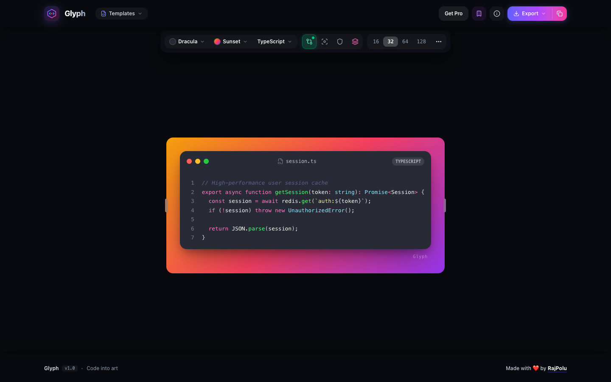

<p align="center">
  <a href="https://github.com/Rajpolu/glyph">
    
  </a>
</p>

<h1 align="center">Glyph</h1>

<p align="center">
  <strong>Turn code into visual stories.</strong><br>
  Aesthetic code snippet screenshots, swipeable social carousels, and animated video clips — crafted for modern developers.
</p>

<p align="center">
  <a href="https://tryglyph.vercel.app"></a>
  <a href="LICENSE"></a>
  <a href="https://nextjs.org"></a>
  <a href="https://react.dev"></a>
  <a href="https://www.typescriptlang.org"></a>
  <a href="https://tailwindcss.com"></a>
  <a href="https://github.com/Rajpolu/glyph/pulls"></a>
</p>

---

<p align="center">
  
</p>

---

## About

**Glyph** is an open-source, ultra-fast web studio built to transform raw source code into high-converting, presentation-grade visual assets. Whether you're sharing code on Twitter/X, publishing a technical breakdown on LinkedIn, writing developer documentation, or designing presentation slides, Glyph eliminates clunky screenshots and delivers borderless elegance in seconds.

Built entirely with **Next.js 16**, **React 19**, **Tailwind CSS v4**, and client-side rendering engines (**Shiki** & **Prism**), Glyph runs 100% locally in your browser with zero latency, zero cloud tracking, and complete privacy.

---

## Features

- 🎨 **Curated Syntax Themes & Gradients**  
  Handcrafted themes including *Dracula*, *Catppuccin Mocha*, *One Dark Pro*, *Nord*, *Tokyo Night*, *GitHub Dark*, and *Cyberpunk*, paired with rich ambient mesh gradients and transparent background options.

- 📱 **Multi-Slide Carousel Studio**  
  Design multi-slide code walkthroughs with dedicated slide navigation. Export directly to **LinkedIn multi-page PDF** decks or download batch PNG slides in one click.

- 🎬 **Animated WebM Video Clips**  
  Generate smooth 2.5-second client-side wipe-reveal video clips (`.webm`) ready to drop into Twitter/X posts, Discord chats, and keynote presentations.

- 🔒 **Automated Secrets Redaction**  
  Built-in heuristic scanning that automatically detects and blurs sensitive API keys, JWT tokens, private credentials, and database connection strings before exporting.

- 🎯 **Line Spotlight & Git Diffs**  
  Emphasize key lines with one-click spotlight dimming, and render native `+` / `-` git diff highlights with customized line coloring.

- 📐 **Dual-Edge Drag-to-Resize**  
  Symmetrical left and right responsive resize handles with subpixel scaling compensation, keyboard shortcuts (<kbd>←</kbd> / <kbd>→</kbd>), and live pixel dimension HUD.

- ⚡ **Retina-Grade Export Engine**  
  Copy directly to clipboard at 2x Retina resolution, download 4x Ultra-HD PNGs, export clean SVGs, or share deep-linked state via compressed URL hashes.

- 🗄️ **Local Snippet Vault**  
  Save, organize, and search your favorite snippet setups locally with zero sign-up required.

---

## How to Use

### 1. Web App
Open the app in your browser, paste your code, choose your theme and gradient backdrop, and click **Export** (or press <kbd>⌘</kbd> + <kbd>C</kbd> to copy 2x PNG directly to your clipboard).

### 2. Local Development Setup

Clone the repository and install dependencies:

```bash
# Clone the repository
git clone https://github.com/Rajpolu/glyph.git

# Navigate into the project directory
cd glyph

# Install dependencies
npm install

# Start the development server
npm run dev
```

Open [http://localhost:3007](http://localhost:3007) with your browser to start creating.

### 3. Production Build

```bash
# Build production bundle
npm run build

# Start production server
npm run start
```

---

## Contributing Guidelines

Contributions, issues, and feature requests are welcome!

1. **Fork the Repository** on GitHub.
2. **Create a Feature Branch**:
   ```bash
   git checkout -b feature/amazing-feature
   ```
3. **Commit Your Changes**:
   ```bash
   git commit -m "feat: add amazing feature"
   ```
4. **Ensure Verification Passes**:
   ```bash
   npx tsc --noEmit
   npm run lint
   ```
5. **Push to the Branch**:
   ```bash
   git push origin feature/amazing-feature
   ```
6. **Open a Pull Request** describing your additions and rationale.

---

## SEO & Topic Tags

`#code-snippets` `#code-to-image` `#carbon-alternative` `#ray-so-alternative` `#developer-tools` `#syntax-highlighter` `#nextjs` `#react-19` `#tailwindcss` `#typescript` `#shiki` `#carousel-generator` `#developer-experience` `#social-cards` `#code-presentation`

---

## License

This project is licensed under the [MIT License](LICENSE) © 2026 [RajPolu](https://github.com/Rajpolu).
